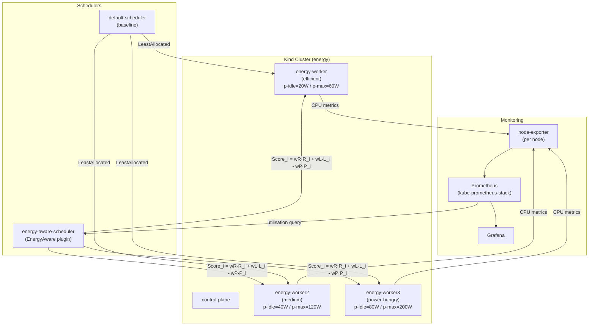

# Energy-Aware Kubernetes Scheduler

> **B.Tech Final-Year Project**  
> Evaluating energy-efficient pod scheduling in a local Kubernetes cluster
> using a custom scheduler plugin that scores nodes on resource availability,
> latency suitability, and estimated power consumption.

---

## Architecture



> **All power values are simulated.** Kind nodes are Docker containers sharing
> one host kernel. No physical power sensors are available.

---

## Scoring Formula

$$\text{Score}_i = w_R \cdot R_i + w_L \cdot L_i - w_P \cdot P_i$$

| Term | Meaning |
|:---|:---|
| $R_i \in [0,1]$ | Resource headroom after placing the pod |
| $L_i \in [0,1]$ | Latency suitability — $1 - u_i / 100$ (idle = 1) |
| $P_i \in [0,1]$ | Normalised estimated power — $P(u_{\text{after}}) / 200\,\text{W}$ |

Node power is estimated as $P(u) = P_{\text{idle}} + u \cdot (P_{\text{max}} - P_{\text{idle}})$
from labels `energy.project/p-idle` and `energy.project/p-max`.

---

## Prerequisites

All commands run inside **WSL2 Ubuntu** from the project root.

| Tool | Required version | Check |
|:---|:---|:---|
| Docker Desktop | WSL2 integration enabled | `docker version` |
| kind | ≥ 0.24 | `kind version` |
| kubectl | ≥ 1.31 | `kubectl version --client` |
| helm | ≥ 3.15 | `helm version --short` |
| Go | ≥ 1.26.0 | `go version` |
| Python 3 | ≥ 3.10 | `python3 --version` |

Install Python dependencies:

```bash
pip install -r scripts/requirements.txt
```

---

## Quick Start

### Option A — Full automated run

```bash
# Clone and enter the repo
git clone <repo-url>
cd schedular

# Run everything: cluster → monitoring → build → deploy → experiments → analysis
bash scripts/run-all.sh
```

Expected total time: 60–90 minutes (first run, includes image downloads).

### Option B — Step by step

#### Step 1 — Create the Kind cluster

```bash
bash scripts/setup-cluster.sh
```

Verify: `kubectl get nodes --context kind-energy`  
Expected: 4 nodes (1 control-plane + 3 workers), all `Ready`.

#### Step 2 — Label worker nodes

```bash
bash scripts/label-nodes.sh
```

Verify:
```bash
kubectl get nodes --context kind-energy \
  -L energy.project/power-profile,energy.project/p-idle,energy.project/p-max
```

#### Step 3 — Install monitoring

```bash
bash scripts/install-monitoring.sh
```

Verify: `kubectl get pods -n monitoring --context kind-energy`  
Expected: All pods `Running`.

#### Step 4 — Build and deploy the energy-aware scheduler

```bash
bash scripts/build-scheduler.sh
bash scripts/deploy-scheduler.sh
```

Verify: `kubectl get pods -n kube-system --context kind-energy -l app.kubernetes.io/name=energy-aware-scheduler`  
Expected: Pod `Running`.

#### Step 5 — View dashboards

```bash
bash scripts/port-forward.sh
```

- Grafana: http://localhost:3000 → Dashboard "Energy-Aware Scheduler — Comparison"
- Prometheus: http://localhost:9090

Retrieve Grafana password:
```bash
kubectl get secret kube-prometheus-stack-grafana \
  -n monitoring --context kind-energy \
  -o jsonpath="{.data.admin-password}" | base64 --decode; echo
```

#### Step 6 — Run a single scenario (quick test)

```bash
kubectl apply -f workloads/scenarios/scenario4-energy-aware.yaml --context kind-energy

kubectl wait --for=jsonpath='{.status.phase}'=Running pod \
  -l energy.project/scenario=scenario4 -n default \
  --context kind-energy --timeout=120s

kubectl get pods -n default --context kind-energy -o wide
```

View scoring logs:
```bash
kubectl logs -n kube-system \
  -l app.kubernetes.io/name=energy-aware-scheduler \
  --context kind-energy --tail=30 | grep "EnergyAware scored"
```

#### Step 7 — Run the full experiment campaign

```bash
# Weight tuning (produces results/week6/tuning.csv)
python3 scripts/tune_weights.py

# Apply tuned weights
kubectl apply -f scheduler/manifests/configmap.yaml --context kind-energy
kubectl rollout restart deployment/energy-aware-scheduler -n kube-system --context kind-energy

# 40 experimental runs: 4 scenarios × 2 schedulers × 5 runs
bash scripts/run-experiments.sh

# Analysis and charts
python3 scripts/analyze_results.py

# Percent-change deltas
python3 scripts/compute_deltas.py
```

#### Step 8 — Tear down

```bash
bash scripts/teardown.sh
```

---

## Results Location

| File | Contents |
|:---|:---|
| `results/week6/summary.csv` | Mean ± std for power, latency, delay, spread (5 runs) |
| `results/week6/tuning.csv` | Weight grid search results |
| `results/week6/charts/` | PNG charts (power, latency, utilisation, sensitivity) |
| `results/week7/deltas.csv` | Percent changes (energy-aware vs default) |

---

## Repository Structure

```text
schedular/
├── cluster/
│   └── kind-config.yaml              KIND cluster definition (1 cp + 3 workers)
├── docs/
│   ├── power-model.md                Node power model and label values
│   ├── scoring-model.md              Scoring formula and weight tuning history
│   ├── environment.md                Pinned tool and package versions
│   ├── contribution.md               Attribution: original vs upstream code
│   ├── final-analysis.md             Per-scenario analysis (post-run)
│   ├── paper-implementation-section.md
│   ├── paper-results-section.md
│   ├── paper-edits.md
│   ├── paper-figures.md
│   ├── demo-script.md
│   ├── demo-fallback.md
│   ├── viva-questions.md
│   ├── peaks-setup.md
│   ├── trimaran-attempt.md
│   └── week*-checklist.md
├── monitoring/
│   ├── values.yaml                   kube-prometheus-stack Helm values
│   └── dashboards/
│       └── scheduler-comparison.json Grafana dashboard
├── results/
│   ├── week5/                        Week 5 raw results (3 runs)
│   ├── week6/                        Week 6 main results (5 runs + tuning)
│   │   ├── summary.csv
│   │   ├── tuning.csv
│   │   └── charts/
│   └── week7/
│       ├── deltas.csv
│       └── demo-backup/
├── scheduler/
│   ├── manifests/                    K8s manifests for energy-aware-scheduler
│   │   ├── configmap.yaml            KubeSchedulerConfiguration (tunable weights)
│   │   ├── deployment.yaml
│   │   ├── rbac.yaml
│   │   └── serviceaccount.yaml
│   └── scheduler-plugins/            Forked kubernetes-sigs/scheduler-plugins
│       └── pkg/energyaware/          ← Original plugin code (this project)
├── scripts/
│   ├── run-all.sh                    Full pipeline (setup → analysis)
│   ├── run-experiments.sh            40-run experiment runner
│   ├── analyze_results.py            CSV aggregation + chart generation
│   ├── tune_weights.py               Weight grid search
│   ├── compute_deltas.py             Percent-change deltas
│   ├── demo.sh                       Interactive demo runner
│   ├── setup-cluster.sh
│   ├── teardown.sh
│   ├── label-nodes.sh
│   ├── install-monitoring.sh
│   ├── build-scheduler.sh
│   ├── deploy-scheduler.sh
│   ├── port-forward.sh
│   └── requirements.txt              Python dependencies
└── workloads/
    ├── load-generator.yaml           fortio load-test Job
    ├── nginx-*.yaml / batch-*.yaml   Individual workload manifests
    └── scenarios/                    Scenario 1-4 manifests (default + EA)
```

---

## Attribution and License

- `scheduler/scheduler-plugins/` is forked from
  [kubernetes-sigs/scheduler-plugins](https://github.com/kubernetes-sigs/scheduler-plugins),
  licensed under the **Apache License 2.0**. The original LICENSE is preserved.
- `pkg/energyaware/`, all manifests, all scripts, and all results are original
  to this project.
- PEAKS ([sustainable-computing-io/peaks](https://github.com/sustainable-computing-io/peaks))
  was studied as a reference implementation; no PEAKS code is in this repository.
- See [docs/contribution.md](docs/contribution.md) for a full file-level attribution list.

---

## Important Notes

- **No real power measurements.** All power values are estimates from a
  simulated linear model. Do not claim real energy savings.
- **KIND ≠ bare metal.** Utilisation measurements reflect container-level
  cgroup accounting on a shared host.
- **Grafana admin password** is auto-generated by Helm and stored in a
  Kubernetes Secret. It is never committed to this repository.
- **Weights are tunable** via `scheduler/manifests/configmap.yaml` without
  rebuilding the image
